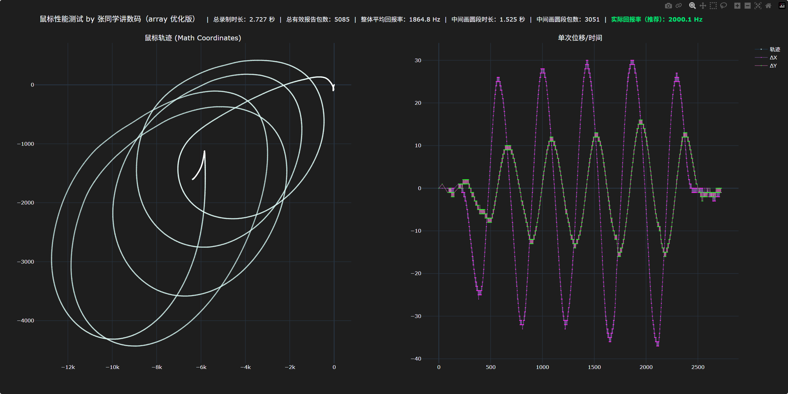

# Mouse Performance Testing Tools

[中文](README.md) | **English**

Screenshots of https://github.com/Nuitfanee/ClickSyncMouseTester/tree/main appear in this README only as examples for explaining mouse performance, because the original mouse is no longer in my possession. Both software projects are open source and free, created for the public good, and there is no plagiarism. Similar functionality raises no legal or ethical concern when it is not for profit, and this kind of feature has long circulated online; it is not exclusive to ClickSyncMouseTester or this open-source project.

## Mouse Performance Testing Tool

It obtains the mouse's raw input from the computer to generate images, displaying the mouse trajectory, per-movement displacement curve, and report-rate data.

Liekong F1 V3, wireless mode

ATK Dragonfly A9 Ultimate, wireless mode

## How to Evaluate Your Mouse's Performance

The main thing to look at is the mouse's per-movement displacement.

The following is a circular-movement per-displacement graph for the VXE Dragonfly V3 Pro in wireless mode. This mouse uses a StarFlash main controller and a 3395 sensor.

Points with large drifts indicate that the mouse has dropped frames. This suggests that the controller's wireless transmission or interference resistance is mediocre.

If the per-movement displacement oscillates back and forth by only a small amount, it means the mouse's responsiveness is not ideal (which is largely related to sensor tuning). Even when used through a wired connection, the per-movement displacement can still fluctuate within a small range.

The performance of a wireless mouse depends on both responsiveness and interference resistance. If interference resistance is poor, the pointer may jump around while moving, suddenly hopping from one point to another (frame dropping). If responsiveness is poor, the mouse feels floaty.

The following is a per-movement displacement graph for the ATK Dragonfly A9 Master Edition in wired mode.

There are no drift points because it is in wired mode, so it will not drop frames like wireless mode.

The per-movement displacement does not fluctuate within a small range, indicating very good responsiveness.

I personally still highly recommend ATK mice. They offer many model choices and comfortable designs, and their performance is among the top domestic tier.
