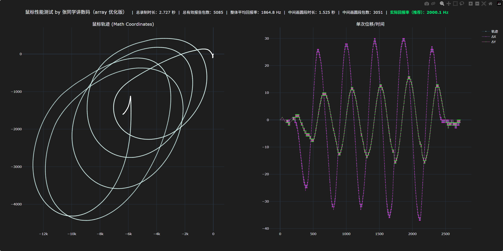

**[English](README_EN.md) | 中文**

readme页面里出现了https://github.com/Nuitfanee/ClickSyncMouseTester/tree/main 这个项目的截图，只是为了举例描述鼠标性能，因为原鼠标已经不在我手里了，两个软件本身都是开源免费的，公益向，根本不存在抄袭。功能相似没有任何法律和道德上的问题，因为不以盈利为目的，而且这种功能早就在网上流传，并非ClickSyncMouseTester或者我这个开源项目独占。

## 测试鼠标性能的工具

通过获取鼠标在电脑上的原始输入绘制图像，显示鼠标轨迹以及单次位移曲线，回报率数据

烈空f1 v3无线模式

ATK 蜻蜓A9 ultimate 无线模式

## 如何看自己鼠标性能

主要看鼠标单次位移

这是vxe的蜻蜓v3 pro无线模式下的画圆单次位移图，这鼠标主控是星闪，3395的传感器

有大幅度漂移的点说明鼠标有丢帧，主控的无线传输或者抗干扰比较一般

 

而单次位移如果在小幅度来回波动，说明鼠标跟手性不太好（跟传感器调教关系比较大），即使插着数据线去用，单次位移依然会在小范围内波动

 

无线鼠标的性能是由跟手性和抗干扰性共同决定的，抗干扰不行鼠标移动时指针会跳动，从一个点突然跳到另一个点（跳帧），跟手性不行，鼠标用起来会觉得飘

而下面是atk的蜻蜓a9大师版有线模式下的单次位移图

 

没有漂移点，因为是有线模式，不会像无线模式一样丢帧

单次位移不会在小范围波动，说明跟手性非常好

我个人还是非常推荐atk的鼠标的，模具选择多，而且模具用起来很舒服，性能也是国产第一梯队

